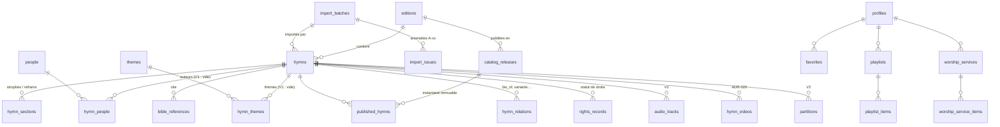

# Modèle de données (PostgreSQL / Supabase)

Source de vérité : `supabase/migrations/` (0001 = schéma V1 fourni, 0002 à 0012 = corrections
et compléments). Ce document en donne la carte ; en cas d'écart, les migrations font foi.

## Vue d'ensemble

## Trois zones

| Zone | Tables | Qui y accède |
|---|---|---|
| **Copie de travail éditoriale** | `editions`, `hymns`, `hymn_sections`, `bible_references`, `hymn_relations`, `people`, `hymn_people`, `themes`, `hymn_themes`, `rights_records`, `import_batches`, `import_issues`, `audit_log` (+ V2 : `audio_tracks`, `audio_segments`, `partitions`, `hymn_videos`) | rôles `editor` / `super_admin` uniquement |
| **Catalogue publié** | `catalog_releases`, `published_hymns` | lecture publique (`anon`) ; écriture par `publish_release()` seulement |
| **Données utilisateur** | `profiles`, `favorites`, `playlists`, `playlist_items`, `worship_services`, `worship_service_items`, `downloads` | chaque utilisateur, sur ses propres lignes |

`user_roles` attribue les rôles applicatifs.

## Règles notables

- **Identité** : tout est identifié par UUID. Le numéro imprimé (`number_label` : `37`,
  `37bis`) est un attribut d'édition, cohérent avec `number_numeric` + `number_suffix`
  (contrainte).
- **Aucune valeur inventée** : les champs inconnus sont `NULL` ; les chaînes vides (espaces
  insécables compris) sont refusées par contrainte.
- **Texte verbatim** : `hymn_sections.text` contient les vers séparés par `\n`, marqueurs
  `(bis)`/`(ter)`/`(4x)` inclus. L'annotation de répétition est calculée à la publication
  (`private.line_repeat`).
- **Statuts** : `draft → review → published` (validé), `archived` ; toute modification de
  contenu d'un cantique validé le repasse en `draft` (trigger). Voir `docs/api/rpc.md`.
- **Releases** : instantané complet du contenu publié ; la version précédente d'un cantique en
  correction est reportée telle quelle (T-009).
- **Synchronisation** : `server_revision` (séquence serveur) + `deleted_at` (pierres
  tombales) sur favoris, listes et programmes (ADR-006).
- **Partage** : `worship_services.share_token` (192 bits), `share_revoked_at`,
  `share_expires_at`.
- **Recherche back-office** : colonnes `search_vector` (français, sans accents) indexées GIN.
